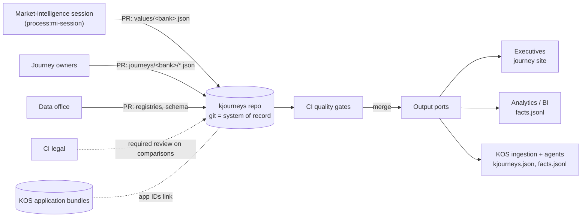
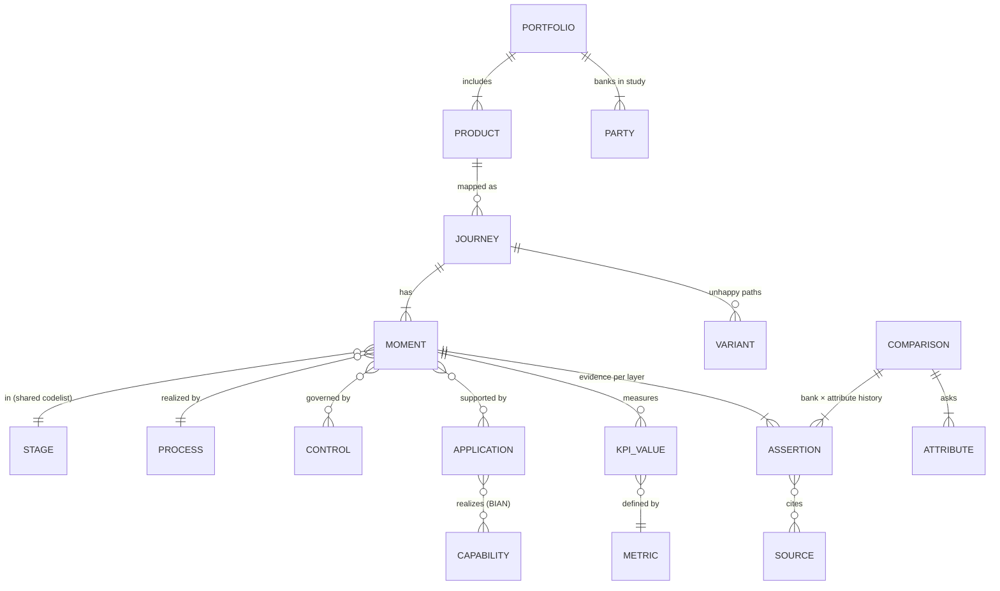
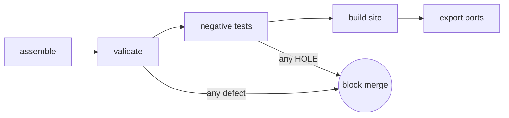

# kjourneys — architecture

kjourneys is a git-native data product. It turns customer-journey knowledge — our own service blueprints and sourced competitor facts — into governed, versioned, machine-checkable data, and publishes it as an executive journey site plus machine-readable output ports.

The descriptor in [`dataproduct.yaml`](../dataproduct.yaml) is the contract. This document explains the design behind it. Decisions are recorded in [`docs/adr/`](adr/).

## 1. Context



## 2. Design principles

1. **Git is the system of record.** Every fact arrives by pull request, is reviewed by its owner, and keeps its full history. No database to drift from. ([ADR-0001](adr/0001-git-as-system-of-record.md))
2. **Small files, clear owners.** Sources are split by owner and by change rate, so concurrent market-intelligence PRs never conflict, and CODEOWNERS can route review precisely. CI assembles them into one instance. ([ADR-0002](adr/0002-split-sources-assembled-instance.md))
3. **Every fact is an assertion.** A value never stands alone. It carries basis, sources, who asserted it, when, and its validity period. Changes supersede, never overwrite. ([ADR-0003](adr/0003-assertions-with-history.md))
4. **The line of visibility is a provenance boundary.** What customers can see is what competitors can see. Above the line, facts can be observed or disclosed for any bank. Below it, facts are internal for us and inferred for everyone else. ([ADR-0004](adr/0004-line-of-visibility-as-provenance-boundary.md))
5. **Quality is code.** The schema, integrity rules, publish gates and negative tests run on every PR. A rule that is not enforced is a wish. ([ADR-0005](adr/0005-quality-gates-as-code.md))
6. **One model, many views.** The executive journey site, the facts export and KOS ingestion all derive from the same assembled instance. Nothing is hand-edited downstream. ([ADR-0006](adr/0006-static-self-contained-outputs.md))

## 3. Logical model



- **Registries** (parties, products, capabilities, applications, metrics, processes, controls, sources) are shared and owned by the data office. Journeys and comparisons reference them by ID or URN.
- **Identity:** `urn:kos:<kind>:<bank>:<local>`. It is immutable once published. Catalog entities are bank-scoped so journeys reuse them.
- **Comparability** comes from three shared vocabularies: the six stages, the attribute catalog (datatype, unit, normalization rule, allowed values), and BIAN service domains.

## 4. Repository layout

```
manifest.json                         manifest: ontology version, study
dataproduct.yaml                   data product contract: owners, ports, gates, SLOs
schema/                            ontology (human) + JSON Schema (machine)
registries/                        shared catalogs                       → data office
data/portfolio.json                banks and products in scope
data/journeys/<bank>/*.json        our journeys                          → journey owners
data/comparisons/<product>/
  comparison.json                  attributes + governance               → CI study lead
  values/<bank>.json               one bank's facts                      → MI session, legal review
tools/                             assemble · validate · build_site · export
tests/                             negative fixtures (must fail) + runner
site/template.html                 journey-site renderer (no data inside)
docs/                              architecture, MI contract, ADRs
```

## 5. Pipeline



| Stage | Tool | Fails when |
|---|---|---|
| Assemble | `tools/assemble.py` | A file's bank or product disagrees with its folder |
| Validate | `tools/validate_journey.py` | Schema, integrity, typing, temporal, provenance or publish-gate rule broken |
| Negative tests | `tests/run_tests.sh` | Any of 29 known-bad fixtures passes |
| Build | `tools/build_site.py` | Template or data missing |
| Export | `tools/export.py` | — (produces facts, coverage, summary; summary is posted to the CI run) |

Run it all locally with `make check`.

## 6. Governance

| Concern | Mechanism |
|---|---|
| Who may change what | CODEOWNERS per folder; branch protection requires owner review and the `kjourneys-ci` check |
| Competitor-intelligence legality | Legal is a required reviewer on `data/comparisons/**`. The validator rejects sample or internal facts for named banks. The publish gate requires approved review. |
| Classification | `governance` block per journey and per comparison (classification, PII, MNPI, retention, access). The validator blocks contradictions (MNPI marked public). |
| Lineage | Assertion → `source_ids` → `registries/sources.json` (URL, retrieved_at), plus git blame for who merged it |
| History and audit | Assertions are append-only, git keeps every state, and releases are tags |
| Hosting | Prototype: personal org, sample data only. Production: enterprise GitHub, private, with SSO. |

## 7. Lifecycle and versioning

- **Schema:** semver in `kjourneys.json` and `schema/`. Minor is additive; major is breaking and ships a migration script. The validator pins the version.
- **Data:** every merge is a version. Executive readouts cite a release tag (`kjourneys-2026-11-20`), so a chart can always be reproduced as of that date.
- **Status:** journeys move `draft → in-review → published → retired`. The validator's publish gate decides whether a status is allowed.

## 8. Path into KOS

This product is deliberately shaped like a KOS knowledge bundle so it can fold in without rework:

1. **Now:** a standalone repo with the same discipline as kbundles (git, PRs, gates, human approval).
2. **Next:** generate the systems lanes of our own journeys from KOS application bundles. Moments already reference app IDs that map to `application-bundles/<appid>/`, so process, controls and interfaces can be drafted from the code graph and confirmed by owners.
3. **Then:** register "journey" as a KOS knowledge-bundle type and this pipeline as its Knowledge Factory recipe. KOS consumers (triage agent, Product Navigator, c4designer) read `facts.jsonl` through the KOS API and MCP server.

## 9. Known limits (tracked)

| Limit | Plan |
|---|---|
| One comparison per instance (Zelle) | Make `comparison` a list keyed by product when the second product's MI begins |
| GRC, CMDB, LEI and BIAN IDs are empty | Filled by system owners. The publish gate blocks release until they are. |
| The page inlines all data (~200 KB today) | Fine to several MB. Beyond that, load `kjourneys.json` as a sibling file. |
| Sample data for our bank | Replace from KOS bundles and journey owners. Sample is never allowed past draft. |
